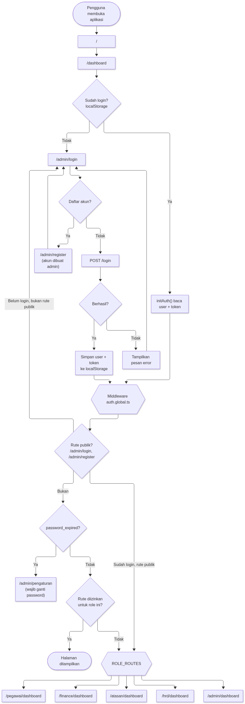
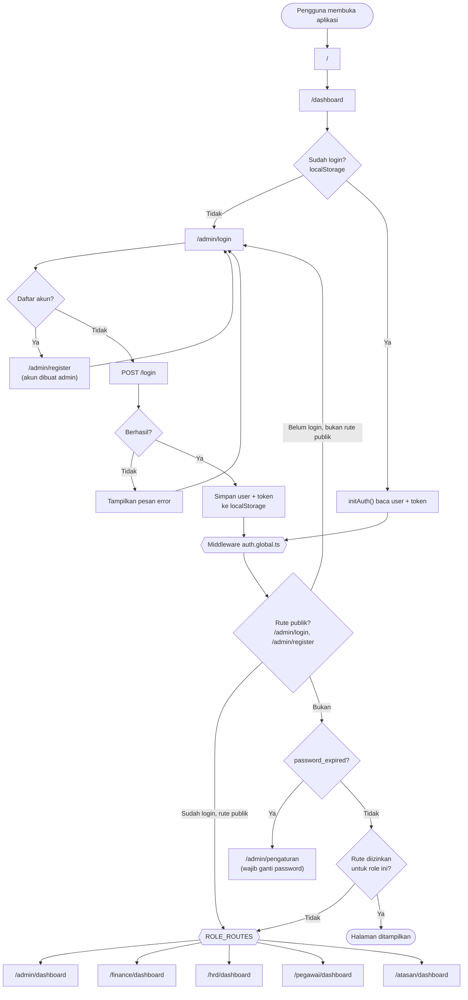
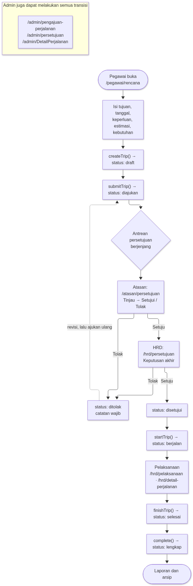
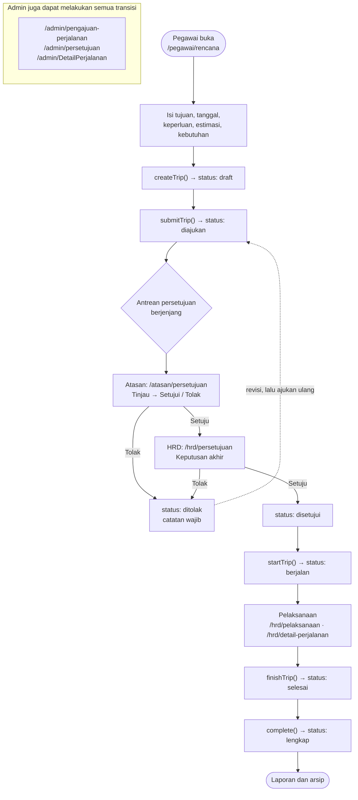
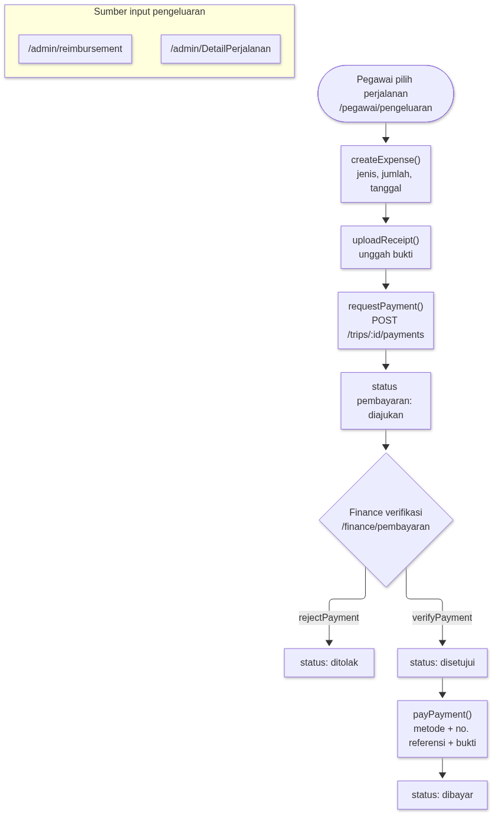
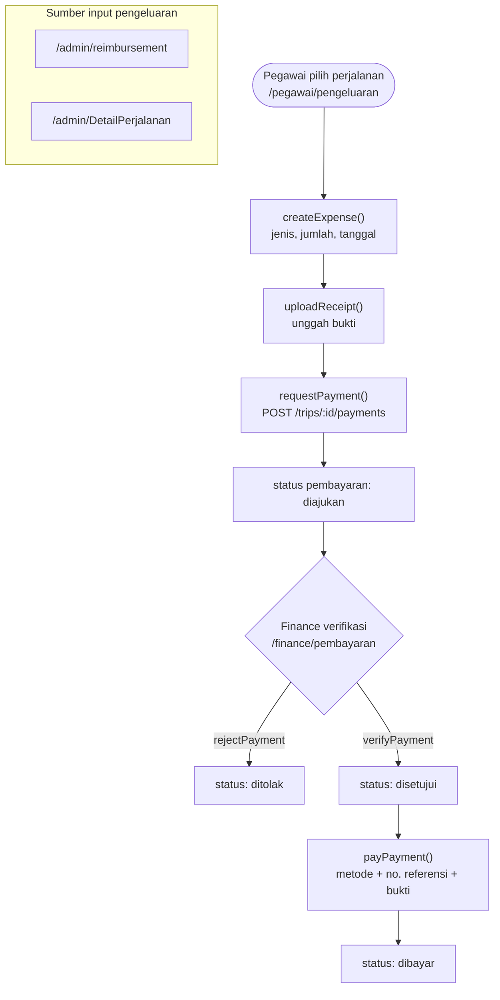
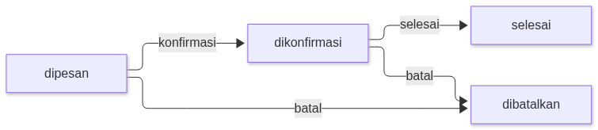
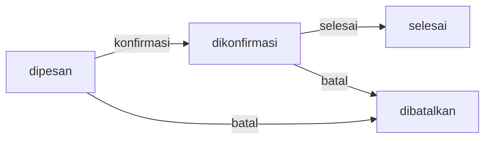
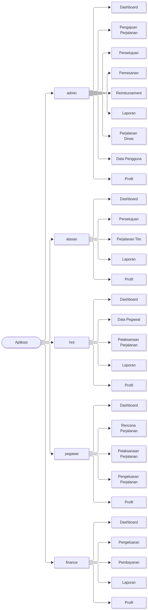
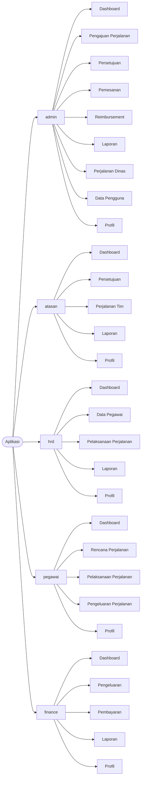

# Alur Aplikasi Eduabsen Travel App

Dokumen ini menjelaskan alur frontend (Nuxt) aplikasi perjalanan dinas:
autentikasi & otorisasi, siklus hidup perjalanan, pengeluaran/pembayaran,
pemesanan, dan navigasi per peran (role).

> Catatan: diagram menggambarkan **perilaku yang terlihat di frontend**.
> Perubahan status final (mis. penomoran level approval) dikendalikan oleh API.

## Peran (Role)

| Role | Ringkasan tugas |
| --- | --- |
| `admin` | Mengelola pengajuan, persetujuan, pemesanan, reimbursement, pagu anggaran, pengguna, log aktivitas, laporan. |
| `atasan` | Menyetujui/menolak pengajuan perjalanan tim (approval level pertama). |
| `hrd` | Persetujuan akhir, data pegawai, memantau pelaksanaan perjalanan, laporan. |
| `pegawai` | Membuat rencana perjalanan, mengelola pengeluaran & pembayaran, pelaksanaan. |
| `finance` | Memverifikasi & membayar pengeluaran, laporan keuangan. |

---

## 1. Autentikasi, Sesi, dan Routing

Keluar: tombol logout memanggil `logout()` → hapus sesi lokal → `POST /logout` → kembali ke `/admin/login`.

---

## 2. Siklus Hidup Perjalanan Dinas (end-to-end)

Status perjalanan: `draft → diajukan → disetujui → berjalan → selesai → lengkap`
(dapat juga berakhir `ditolak`).

Aksi perjalanan yang tersedia di `useTrips` / `useApprovals`:
`submit`, `approve`, `reject`, `start`, `finish`, `complete`, `archive`,
`unarchive`, `duplicate`, unggah dokumen, unduh SPT/SPD, unduh kalender (`.ics`).

---

## 3. Pengeluaran & Pembayaran (Reimbursement)

Pagu anggaran per departemen/periode dikelola di `/admin/anggaran`.

---

## 4. Pemesanan (Booking)

Jenis: tiket pesawat, tiket kereta, hotel, transport lokal, lainnya.

Dibuat/diubah dari `/admin/pemesanan` (dan opsi booking pada halaman pengeluaran pegawai).

---

## 5. Navigasi per Role

---

## 6. Peta Halaman (route)

| Route | Peran yang diizinkan |
| --- | --- |
| `/admin/*` | admin |
| `/finance/dashboard`, `/finance/pengeluaran`, `/finance/pembayaran`, `/finance/laporan` | finance |
| `/hrd/dashboard`, `/hrd/data-pegawai`, `/hrd/pelaksanaan`, `/hrd/persetujuan`, `/hrd/laporan`, `/hrd/detail-perjalanan/*`, `/hrd/pegawai-detail` | hrd |
| `/pegawai/dashboard`, `/pegawai/rencana`, `/pegawai/pengeluaran`, `/pegawai/laporan`, `/hrd/pelaksanaan` | pegawai |
| `/atasan/dashboard`, `/atasan/persetujuan`, `/atasan/persetujuan/*`, `/atasan/perjalanan-tim`, `/atasan/perjalanan-tim/*`, `/atasan/laporan` | atasan |
| `/admin/pengaturan` | semua peran (profil) |

Sumber aturan: `app/middleware/auth.global.ts` (`getAllowedRoutesForRole`) dan `app/utils/nav.ts`.
