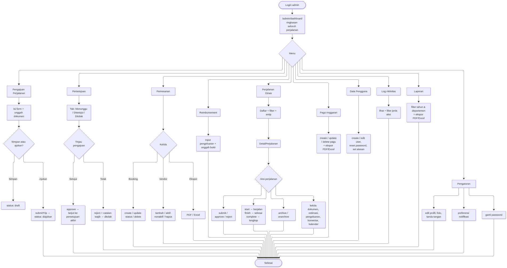
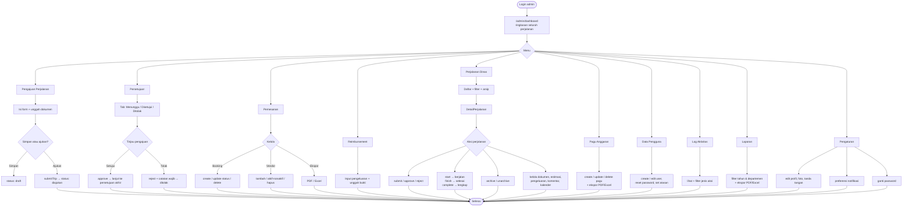
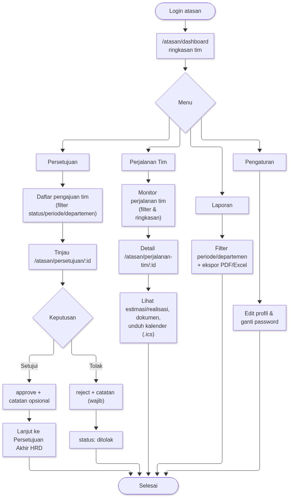
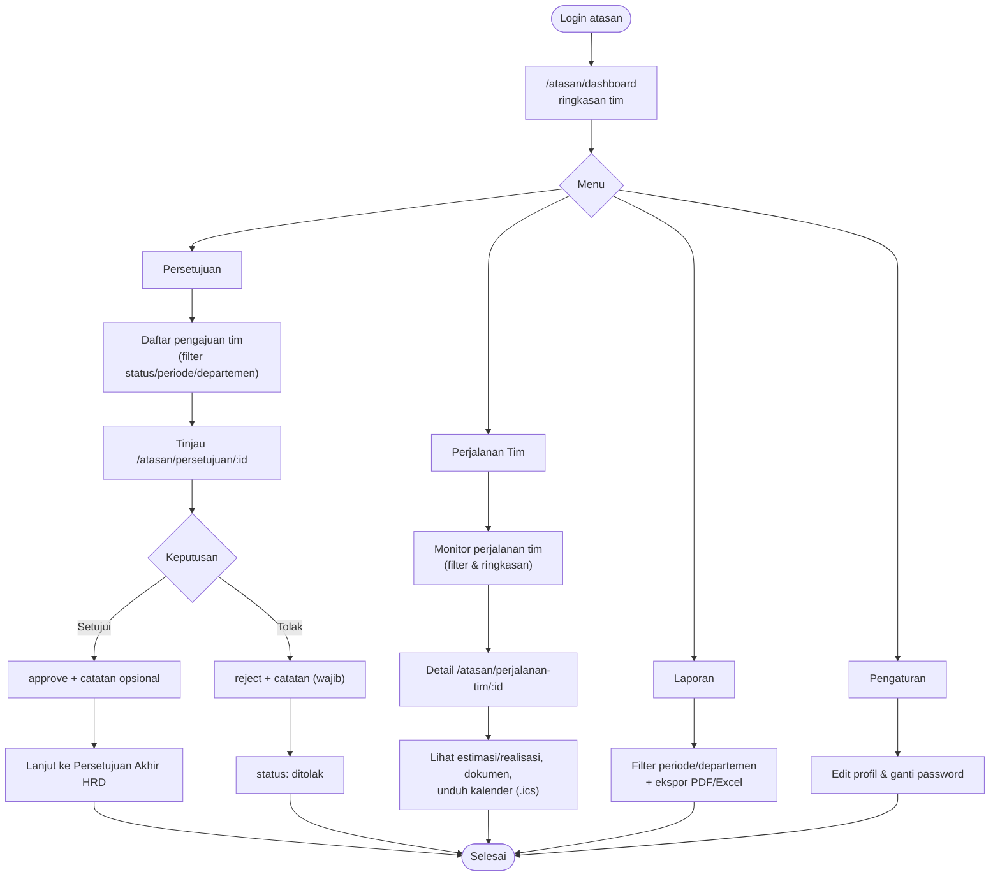
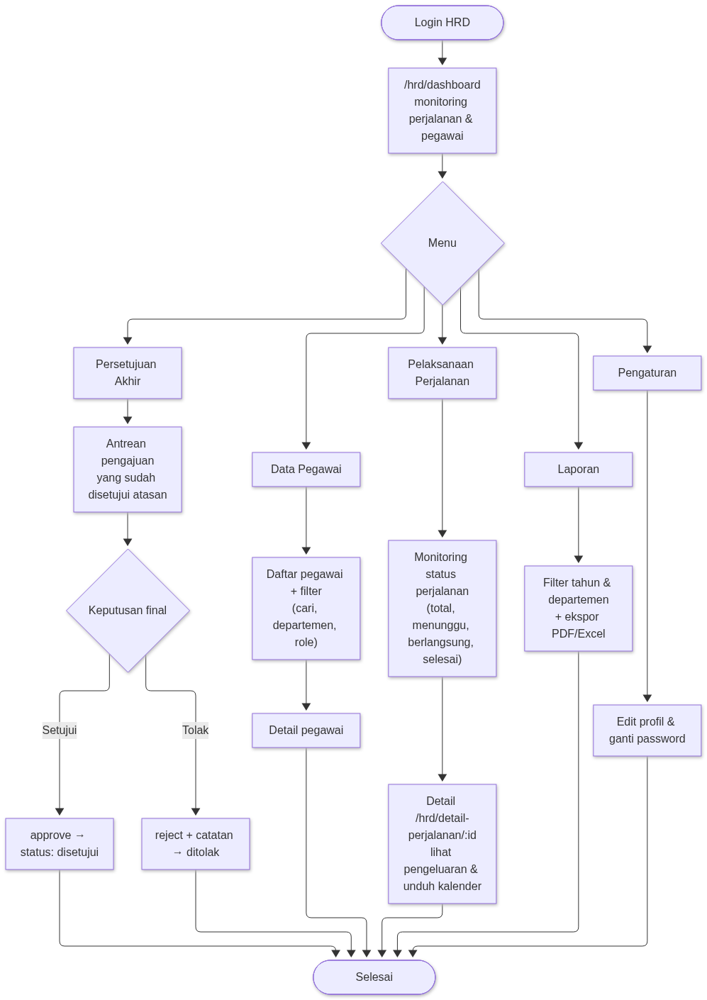
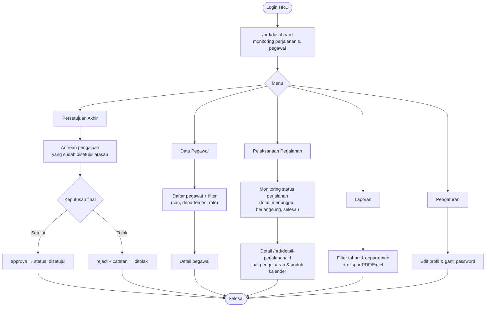
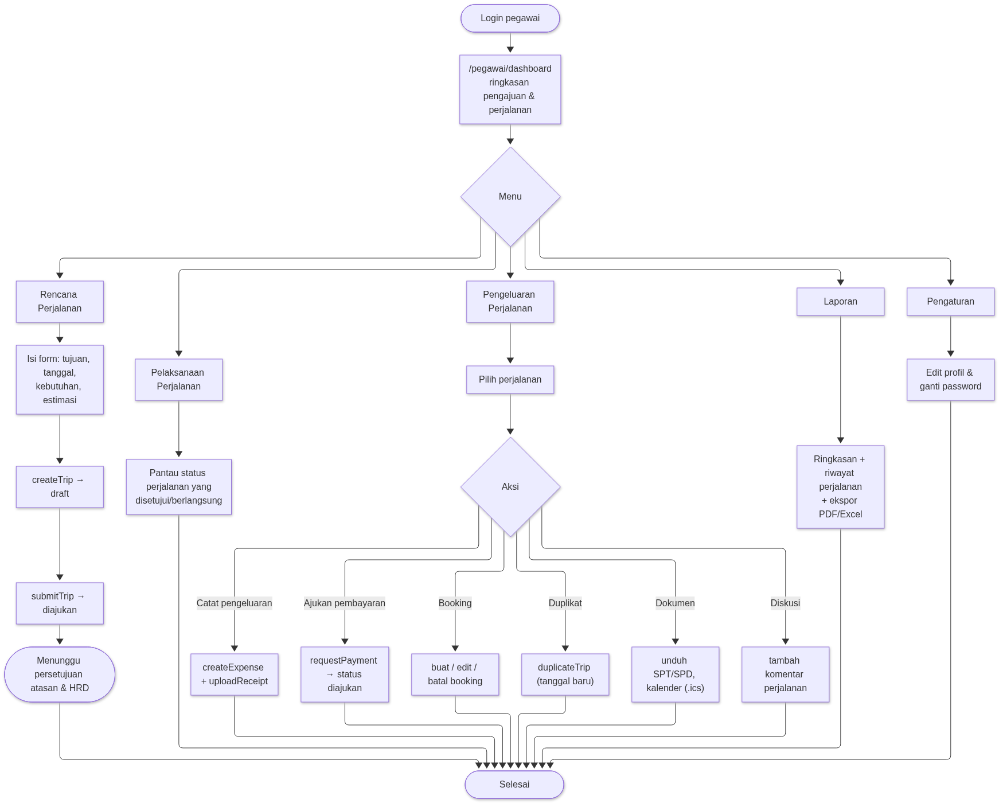
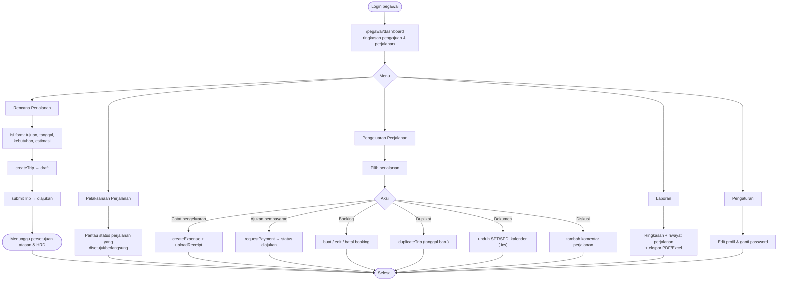
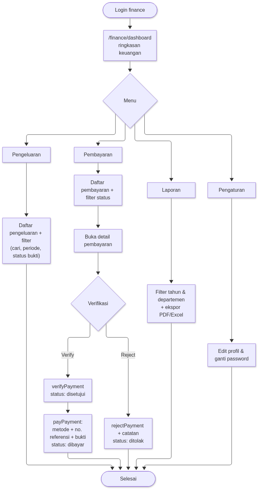
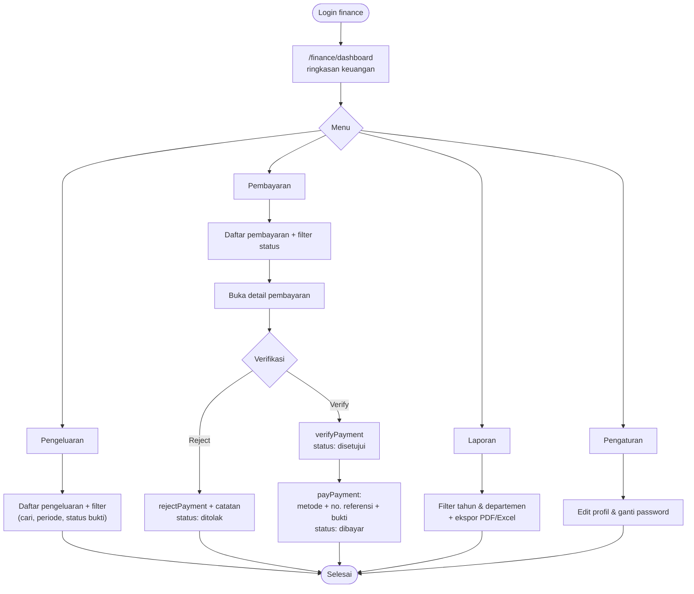

# Alur Aplikasi per Role — Eduabsen Travel App

Kumpulan flowchart untuk **setiap peran pengguna**: `admin`, `atasan`, `hrd`,
`pegawai`, dan `finance`. Semua alur dimulai dari login dan bercabang ke
menu sesuai hak akses (`app/middleware/auth.global.ts` + `app/utils/nav.ts`).

Legenda umum: `[...]` = halaman/aksi, `{...}` = keputusan, `([...])` = awal/akhir.

> Lihat `docs/ALUR-APLIKASI.md` untuk alur lintas-role (siklus perjalanan, pembayaran, booking).

---

## 1. Admin

---

## 2. Atasan

---

## 3. HRD

---

## 4. Pegawai

---

## 5. Finance

---

## Ringkasan Hak Akses

| Role | Menu utama | Aksi kunci |
| --- | --- | --- |
| **admin** | Dashboard, Pengajuan, Persetujuan, Pemesanan, Reimbursement, Perjalanan Dinas, Anggaran, Data Pengguna, Log Aktivitas, Laporan, Pengaturan | Semua transisi perjalanan, kelola booking/vendor/pagu/pengguna |
| **atasan** | Dashboard, Persetujuan, Perjalanan Tim, Laporan, Pengaturan | Setujui/tolak pengajuan tim (level pertama) |
| **hrd** | Dashboard, Data Pegawai, Persetujuan Akhir, Pelaksanaan, Laporan, Pengaturan | Keputusan final pengajuan, data pegawai, monitoring |
| **pegawai** | Dashboard, Rencana, Pelaksanaan, Pengeluaran, Laporan, Pengaturan | Buat/lancarkan perjalanan, pengeluaran, pembayaran, booking |
| **finance** | Dashboard, Pengeluaran, Pembayaran, Laporan, Pengaturan | Verifikasi, tolak, dan proses pembayaran |
